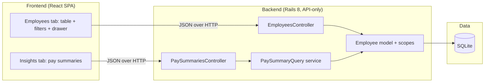

# Architecture

> Extracted from [§7](docs/specs/001-employee-salary-management-spec.md#7-architecture) of [spec 001](docs/specs/001-employee-salary-management-spec.md) on 2026-10-01. Future Anthara commands treat this file as the authoritative, project-wide architectural reference.

## 1. Style and rationale

**Style:** Modular monolith.

One Rails app, one SQLite database, a single team, and a CRUD-plus-aggregate-query workload at a bounded 10,000-row scale have no independent-scaling or independent-deploy requirement that would justify microservices, and no domain complex enough to warrant hexagonal ports or CQRS's read/write split. A modular monolith — standard Rails MVC with business logic pushed into models and plain-Ruby service objects — is the simplest structure that correctly fits the requirements.

## 2. Tech stack

| Layer | Choice | Rationale |
|---|---|---|
| Backend runtime | Ruby on Rails 8, API-only mode | Matches the role this project is built for and the brief's language/framework preference; `--api` mode drops view/asset machinery not needed by a pure JSON backend. |
| Database | SQLite | Sufficient for 10,000 rows with proper indexes; keeps the project runnable with zero external DB setup. |
| Frontend | React SPA built with Vite | A pure client talking to the JSON API, with no SEO/server-rendering need, so Next.js's SSR/routing machinery wasn't justified. |
| Component library | shadcn/ui + Tailwind CSS | Accessible-by-default primitives (Radix), no heavy runtime theme system, fast to compose into a data table, forms, and a drawer. |
| Client server-state | TanStack Query | Declarative caching, pagination, and refetch-after-mutation for a table-heavy CRUD app. |
| Hosting | Local development only | No deployment target specified; out of scope. |
| Auth | None (v1) | Single implicit HR Manager role; see spec [§9.2](docs/specs/001-employee-salary-management-spec.md#9-deferred-follow-ups-and-accepted-limits). |

## 3. Dependency rules

Controllers → services/query objects (`app/services`) → models (`app/models`) → database. Dependencies point one direction only:

- Controllers depend on services and models; nothing depends back on a controller.
- Services depend on models; models never call into services or controllers.
- The frontend depends on the backend's JSON contract only — it never reaches into Rails internals.

## 4. Module map

| Module | Responsibility |
|---|---|
| `EmployeesController` | Parses params, calls `Employee` scopes, renders JSON; no business logic. |
| `PaySummariesController` | Parses `group_by`/filter params, calls `PaySummaryQuery`, renders JSON. |
| `Employee` (model) | Validations (presence, non-negative salary, unique email), query scopes (filter by country/department/job_title/salary range). |
| `PaySummaryQuery` (PORO service) | Builds the currency-safe, database-side `GROUP BY` aggregate query for headcount/payroll cost/salary distribution. |
| Frontend `Employees tab` | Table, pagination, filter bar, detail drawer, create/edit forms. |
| Frontend `Insights tab` | Renders pay-summary stat tiles/breakdown table. |

## 5. Cross-cutting concerns

- **Auth:** none in v1 (accepted limit, spec [§9.2](docs/specs/001-employee-salary-management-spec.md#9-deferred-follow-ups-and-accepted-limits)).
- **Logging:** `Rails.logger` only in application code, never `puts`/`print` (RuboCop `Rails/Output`).
- **Error handling:** uniform JSON error shape via `ApplicationController#rescue_from` (`404`/`422`/`400`).
- **Validation:** ActiveRecord validations plus matching database constraints (`null: false`, unique indexes) — validations alone are not trusted to hold under bulk writes.
- **Observability:** none beyond Rails' default logging; not required at this scale or scope.
- **Feature flags:** none; the app has one deployment target.
- **Migrations:** every schema change is a reversible Rails migration; `db/schema.rb` is committed alongside.
- **Audit:** none — no change history is tracked (accepted limit, spec [§9.3](docs/specs/001-employee-salary-management-spec.md#9-deferred-follow-ups-and-accepted-limits)).

## 6. Integration points

| System | Owning module | Contract | Failure mode |
|---|---|---|---|
| React SPA ↔ Rails API | `EmployeesController`, `PaySummariesController` | JSON over HTTP, CORS allow-listed via `rack-cors` | Non-2xx responses carry a structured `{code, message}` (or per-field errors) JSON body; the frontend surfaces these inline rather than crashing. |
| `db/seeds.rb` ↔ SQLite | Seed script | `Employee.insert_all` in 1,000-row batches, inside a transaction | A failed batch rolls back the whole seed run; re-running `db:seed` is idempotent (clears/upserts first). |

No third-party or external network integrations exist in v1 — there is no FX-rate service, no auth provider, and no external API dependency.

## 7. Forbidden anti-patterns

- No business logic in controllers — it belongs in model scopes or `app/services` POROs.
- No controller-to-controller calls.
- No raw SQL string interpolation of request data (hash conditions or bind placeholders only).
- No bypassing ActiveRecord validations via `update_column`/`update_all`/`update_attribute` on validated attributes.
- No summing or averaging salary amounts across differing currencies.

## 8. How to evolve

- **Adding a module:** new business logic beyond simple CRUD gets its own PORO under `app/services`, named for what it does (e.g. `PaySummaryQuery`), never bolted onto a controller or model.
- **Splitting:** if `Employee` accumulates unrelated responsibilities (e.g. a future salary-history feature), extract a new model (`SalaryRecord`) and a matching service, keeping one model per type-ontology concept (spec [§3](docs/specs/001-employee-salary-management-spec.md#3-type-ontology)).
- **Deprecating:** remove the controller action, its route, its service/model code, and its tests in the same change; do not leave dead routes or orphaned POROs.

## 9. Decision records (ADRs)

**ADR 1 — Modular monolith over hexagonal/CQRS.** Chosen because the workload (CRUD + aggregate queries, single team, bounded 10k-row scale, no independent-scaling need) doesn't justify the added indirection of hexagonal ports or the read/write split of CQRS. See spec [§7.2](docs/specs/001-employee-salary-management-spec.md#72-architectural-style).

**ADR 2 — Salary stored as-paid, no FX conversion.** Decimal amount + ISO 4217 currency per employee; aggregates grouped by currency, never summed across currencies. No live/verifiable FX-rate source was available, and a baked-in static rate would mislead anyone trusting a cross-country total. See spec [§9.4](docs/specs/001-employee-salary-management-spec.md#9-deferred-follow-ups-and-accepted-limits) and [invariant 4.5](docs/specs/001-employee-salary-management-spec.md#4-invariants).

## 10. References

- Spec: [`docs/specs/001-employee-salary-management-spec.md`](docs/specs/001-employee-salary-management-spec.md), §7 Architecture.
- Org Memory (`mcp__plugin_anthara_anthara-fabric__search_memories`: "salary-kata employee salary management Rails architecture design decisions") — returned no prior facts; this is the first architectural record for this project.
- `kata.md` (repo root) — the originating assignment brief.
