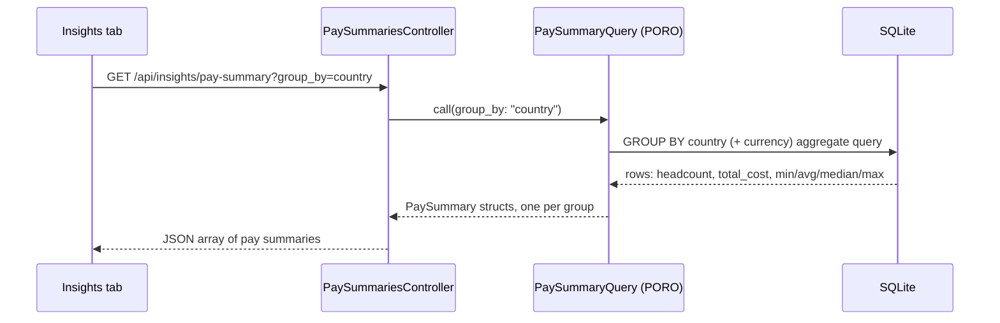
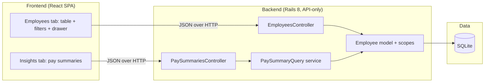

# Spec: Give ACME's HR Manager a web tool to manage and understand 10,000 employees' salaries, replacing spreadsheets

> Owned by: Avani Prajapati · Started: 2026-10-01 · Last revised: 2026-10-01 · Spec UUID: e9edd47b-dec9-49a2-808a-07e86f0f5807
> Anthara spec — slice-decomposed, categorically-framed. Feeds /anthara:create-ticket and /anthara:plan-implementer.

---

## At a glance

| | |
|---|---|
| **In one line** | A Rails API + React SPA that lets the HR Manager browse, edit, and ask aggregate pay questions about 10,000 employees across countries, replacing per-country spreadsheets. |
| **Slices** | 7, built in the order listed in [§5](#5-slices) |
| **Architectural style** | Modular monolith, from [§7.2](#72-architectural-style) |
| **Active packs** | Accessibility Checklist, Clean Code, Incubyte Engineering Standards, Rails Backend Standards, Rails Testing Standards, RuboCop Violations (Ruby/Rails), SonarJS Violations (JavaScript/TypeScript) |
| **Open questions** | 0 — every elicitable unknown was resolved in this session (see [§8](#8-open-questions)) |

## 1. Overview & business context

**The problem.** ACME's HR team currently tracks salary data for 10,000 employees across multiple countries in spreadsheets. This is tedious to maintain, error-prone to edit safely, and makes it hard to answer simple organizational questions ("what's our average salary in Germany?", "how many people do we employ in each country, and what does that cost?") without manual spreadsheet gymnastics.

**Who it is for.** The **HR Manager** ([§3.1](#31-kinds-of-users)) — the sole user kind in v1 — who needs to view, add, edit, and remove employee salary records, and to see organization-wide pay answers without exporting to a separate analysis tool.

**What this spec commits to.** A Rails 8 JSON API backend (SQLite) and a React single-page app that together give the HR Manager a searchable, paginated employee directory with full CRUD, and an Insights view answering headcount, payroll cost, and salary-distribution questions grouped by country, department, and job title. A seed script populates 10,000 employees so the tool is usable and testable at realistic scale from day one.

**Deliberately out of scope.** No login/authentication, no salary history or raise tracking, no currency conversion/normalization across countries, no department or country management screens (these are validated attributes, not managed entities), and no org-chart/manager-hierarchy modeling. Each exclusion is reasoned in [§9](#9-deferred-follow-ups-and-accepted-limits).

## 2. Sources

| ID | Type | Contributor | Date | Description |
|---|---|---|---|---|
| 1 | kata.md (repo root) | Benchmark Harness | 2026-10-01 | The assignment brief: goal, persona, problem statement, technical constraints, and submission expectations. Treated as authoritative over all derived summaries. |
| 2 | Fabric standards catalog (`mcp__plugin_anthara_anthara-fabric__list_standard_packs` / `get_relevant_standards`) | Fabric | 2026-10-01 | Rails Backend Standards, Rails Testing Standards, RuboCop Violations (Ruby/Rails), Clean Code, Accessibility Checklist, Incubyte Engineering Standards, SonarJS Violations. Each rule embeds its own official-docs citation (Rails guides, RuboCop docs) where one exists; those URLs are reused in [§6](#6-nfrs--regulatory-compliance) rather than independently re-fetched (no WebFetch/WebSearch tool was available in this session). |
| 3 | Org Memory (`mcp__plugin_anthara_anthara-fabric__search_memories`: "salary-kata employee salary management Rails architecture design decisions") | Fabric | 2026-10-01 | Returned no prior facts — confirms there is no earlier Anthara decision to inherit for this repo; this spec starts the record. |
| 4 | Codebase (this repo) | n/a | 2026-10-01 | Greenfield at session start: only `kata.md` present, no app code, no `docs/specs/`, no `README.md`/`CLAUDE.md`. |
| 5 | Live spec-writing session with Avani Prajapati | Avani Prajapati | 2026-10-01 | In-session decisions: analytics scope, currency model, auth scope, component library, Rails API mode, pagination model, real-time need, client state strategy, feature layout, and architectural style — each captured via `AskUserQuestion` with a recommended default accepted in every case. |

## 3. Type ontology

### 3.1 Kinds of users
- **HR Manager** — the sole user kind in v1; manages employee salary records and reads organization-wide pay aggregates. No login distinguishes multiple HR Managers in v1 [1, 5].

### 3.2 Kinds of data
- **Employee record** — first name, last name, email (organization-unique), job title, department, country, hire date, and current salary. Not regulated PHI/PCI (confirmed: no compliance pack beyond general engineering/accessibility packs is active for this repo), but handled as sensitive HR PII throughout [1, 2].
- **Current salary** — a decimal amount paired with an ISO 4217 currency code, embedded on the employee record. Exactly one per employee; no history [1, 5].
- **Pay summary (aggregate)** — a computed, non-persisted view: headcount, total payroll cost, and min/avg/median/max salary, grouped by country, department, or job title [5].

### 3.3 Kinds of events
- **Employee added** — an HR Manager creates a new employee record via [slice 5.4](#54-add-a-new-employee).
- **Employee updated** — profile fields or current salary change via [slice 5.5](#55-edit-an-employees-profile-and-salary).
- **Employee removed** — a record is deleted via [slice 5.6](#56-remove-an-employee-record).

### 3.4 Kinds of states
No employee lifecycle state machine exists in v1 — an employee record either exists or has been removed ([§9.3](#9-deferred-follow-ups-and-accepted-limits)). This section is intentionally thin: the domain has no workflow states to enumerate.

## 4. Invariants

**4.1 Unique identity** — Every employee has exactly one organization-unique email address. Sources: [1, 5].

**4.2 Non-negative priced salary** — Every employee's current salary is a non-negative decimal amount paired with an ISO 4217 currency code. Sources: [2, 5].

**4.3 Complete classification** — Every employee belongs to exactly one country, one department, and one job title at all times; none of the three is ever blank. Sources: [1, 5].

**4.4 Bounded listing** — No list endpoint returns more records than its declared, server-enforced page size in a single response, regardless of what the caller requests. Sources: [2].

**4.5 Currency-safe aggregation** — Salary aggregates are grouped by currency and never summed or averaged across employees paid in differing currencies. See the accepted-limit ADR at [§9.4](#9-deferred-follow-ups-and-accepted-limits). Sources: [5].

## 5. Slices

| # | Slice | What the user can do once it lands | Entry | Reached from |
|---|---|---|---|---|
| 5.1 | Browse the paginated employee directory | View all employees in a sortable, paginated table | Employees tab (employee table) | `root` |
| 5.2 | Filter and search the employee directory | Narrow the table by country, department, job title, salary range, or name/email | Filter/search bar above the table | Employees tab (5.1) |
| 5.3 | View an employee's full record | Open one employee's full details without losing table context | Row "View" action → detail drawer | Employees tab table row (5.1) |
| 5.4 | Add a new employee | Create a new employee + salary record | "Add employee" button | Employees tab (5.1) |
| 5.5 | Edit an employee's profile and salary | Change any employee field including current salary | "Edit" action in the detail drawer | Employee detail drawer (5.3) |
| 5.6 | Remove an employee record | Delete an employee record | "Remove" action in the detail drawer | Employee detail drawer (5.3) |
| 5.7 | View org-wide pay insights | See headcount, payroll cost, and salary distribution by country/department/job title | Insights tab | `root` |

### 5.1 Browse the paginated employee directory

The HR Manager opens the app and lands on the **Employees** tab, which shows a sortable table of employee records — name, job title, department, country, current salary with its currency, and hire date — drawn from the full 10,000-row seeded dataset, one bounded page at a time.

*Types: Employee record, current salary ([§3.2](#32-kinds-of-data)) · Invariants: [4.4 Bounded listing](#4-invariants).*

**Acceptance criteria**

- [ ] **5.1.1** `GET /api/employees` returns a JSON page (`id, first_name, last_name, job_title, department, country, salary_amount, salary_currency, hire_date`) plus a pagination envelope (`page, per_page, total_count, total_pages`), accepting `page` and `per_page` query params.
- [ ] **5.1.2** The Employees tab renders the returned page as a table with sortable columns (name, department, country, salary, hire date) and next/prev/page-number controls.
- [ ] **5.1.3** A `per_page` above the server-enforced cap is clamped to the cap rather than erroring or being honored as-is (ties [4.4](#4-invariants); Rails Backend Standards — paginate every index endpoint).
- [ ] **5.1.4** With the database seeded via `bin/rails db:seed` (10,000 employees), loading any page issues a bounded, constant number of queries regardless of page content (asserted by a request test with `strict_loading` enabled in the test environment) — no N+1 pattern.
- [ ] **5.1.5** Requesting a page beyond `total_pages` returns `200` with an empty array, not an error.

### 5.2 Filter and search the employee directory

From the Employees tab, the HR Manager narrows the table using a filter/search bar: by country, department, job title, a salary range, or free-text name/email search — combinable, without leaving the table.

*Types: Employee record ([§3.2](#32-kinds-of-data)) · Invariants: [4.4](#4-invariants).*

**Acceptance criteria**

- [ ] **5.2.1** `GET /api/employees` accepts `country`, `department`, `job_title`, `min_salary`, `max_salary`, and `q` (name/email search) query params, combinable, applied through indexed hash-condition queries.
- [ ] **5.2.2** No filter value is ever interpolated directly into a raw SQL string; all conditions use hash conditions or bind placeholders (Rails Backend Standards — SQL injection countermeasure).
- [ ] **5.2.3** Clearing all filters returns the full paginated directory from [5.1](#51-browse-the-paginated-employee-directory).
- [ ] **5.2.4** An invalid filter value (e.g. non-numeric `min_salary`) returns `400` with a structured JSON error body, not a `500`.

### 5.3 View an employee's full record

Clicking a row in the directory opens a side-panel drawer showing that employee's complete record, with the table's scroll position and active filters preserved underneath.

*Types: Employee record ([§3.2](#32-kinds-of-data)) · Invariants: [4.3](#4-invariants).*

**Acceptance criteria**

- [ ] **5.3.1** `GET /api/employees/:id` returns the full employee record.
- [ ] **5.3.2** Clicking a table row opens the detail drawer in place, without navigating away from or resetting the Employees tab's table/filter state.
- [ ] **5.3.3** Requesting a non-existent `id` returns `404` with a structured JSON error body (`rescue_from ActiveRecord::RecordNotFound`).

### 5.4 Add a new employee

From the Employees tab, the HR Manager opens an "Add employee" form and creates a new employee record with its starting salary.

*Types: Employee record, current salary ([§3.2](#32-kinds-of-data)) · Invariants: [4.1](#4-invariants), [4.2](#4-invariants), [4.3](#4-invariants).*

**Acceptance criteria**

- [ ] **5.4.1** `POST /api/employees` accepts `first_name, last_name, email, job_title, department, country, hire_date, salary_amount, salary_currency` via strong parameters (`params.expect`, Rails 8) and creates the record.
- [ ] **5.4.2** A missing required field or an invalid salary (negative or non-numeric) returns `422` with per-field validation messages; the form surfaces them inline next to the offending field.
- [ ] **5.4.3** A duplicate email returns `422`, backed by a database unique index (not validation alone) — ties [4.1](#4-invariants); Rails Backend Standards — back every uniqueness validation with a unique index.
- [ ] **5.4.4** On success, the new employee appears in the directory ([5.1](#51-browse-the-paginated-employee-directory)) without a full page reload.

### 5.5 Edit an employee's profile and salary

From the detail drawer, the HR Manager edits any field on an existing employee, including their current salary and currency.

*Types: Employee record, current salary ([§3.2](#32-kinds-of-data)) · Invariants: [4.1](#4-invariants), [4.2](#4-invariants), [4.3](#4-invariants).*

**Acceptance criteria**

- [ ] **5.5.1** `PATCH /api/employees/:id` updates permitted fields via strong parameters (`params.expect`).
- [ ] **5.5.2** Changing `salary_amount` or `salary_currency` re-validates non-negativity and a well-formed ISO 4217 currency code before saving.
- [ ] **5.5.3** An invalid update returns `422` with field-level errors; updating a removed/non-existent employee returns `404`; on success the UI reflects the server's saved values (not an optimistic client-side guess).

### 5.6 Remove an employee record

From the detail drawer, the HR Manager removes an employee record after confirming the destructive action.

*Types: Employee record ([§3.2](#32-kinds-of-data)).*

**Acceptance criteria**

- [ ] **5.6.1** `DELETE /api/employees/:id` removes the record and returns `204`.
- [ ] **5.6.2** The UI requires an explicit confirmation step before issuing the delete request.
- [ ] **5.6.3** Removing a non-existent `id` returns `404`.
- [ ] **5.6.4** After removal, the employee no longer appears in [5.1](#51-browse-the-paginated-employee-directory)'s directory, and is excluded from any pay aggregate computed afterward.

### 5.7 View org-wide pay insights

The HR Manager switches to the **Insights** tab and sees, without exporting anything: headcount and total payroll cost per country, and salary distribution (min/avg/median/max) broken down by country, department, or job title.

*Types: Pay summary (aggregate) ([§3.2](#32-kinds-of-data)) · Invariants: [4.5 Currency-safe aggregation](#4-invariants).*

**Acceptance criteria**

- [ ] **5.7.1** `GET /api/insights/pay-summary` returns one row per `(country, currency)` pair actually present in the data — headcount, total payroll cost, and min/avg/median/max current salary — so a country with employees paid in more than one currency yields one row per currency rather than one misleading blended row.
- [ ] **5.7.2** `GET /api/insights/pay-summary` accepts a `group_by` param (`country` | `department` | `job_title`) and returns the same aggregate shape, still partitioned by currency within each group.
- [ ] **5.7.3** All aggregates are computed with database-side `GROUP BY`/aggregate functions (never a Ruby-side loop over all 10,000 records); a request test asserts both correctness and that query time on the seeded dataset stays under 500ms.
- [ ] **5.7.4** Aggregates are never summed or averaged across employees paid in differing currencies without a currency-safe grouping key (ties [4.5](#4-invariants)); covered by a service unit test using fixtures where one country has employees in two currencies.
- [ ] **5.7.5** The Insights tab renders per-country headcount/cost and the breakdown table, with a visible "amounts shown as paid, not currency-converted" disclosure (ties the accepted-limit ADR at [§9.4](#9-deferred-follow-ups-and-accepted-limits)).

## 6. NFRs & regulatory compliance

No regulated compliance pack (HIPAA, PCI, SOC 2, FDA SaMD, GDPR) is active for this repo — only general engineering and accessibility packs. NFRs below are drawn from those.

### 6.1 Rails Backend Standards

**6.1.1 Money is decimal with explicit currency, never float** — `salary_amount` is `decimal(precision: 12, scale: 2)`, `salary_currency` a separate ISO 4217 column. Derived from rule: "Store money as decimal with explicit precision and scale, never float, and store the currency." Sources: [2].

**6.1.2 Database-enforced integrity** — `null: false` on required columns, a unique index backing the email uniqueness validation, and indexes on `country`, `department`, `job_title` (filter/sort columns). Derived from rule: "Enforce integrity in the database: null: false, foreign keys and indexes." Sources: [2].

**6.1.3 Every list endpoint is paginated and capped** — ties [4.4](#4-invariants) and AC 5.1.1/5.1.3. Derived from rule: "Paginate every index endpoint; never return an unbounded .all." Sources: [2].

**6.1.4 Strong parameters via `params.expect`** — every create/update action filters input with Rails 8's `params.expect`, never raw `params`. Derived from rule: "Permit request attributes with params.expect; never mass-assign raw params." Sources: [2].

**6.1.5 Uniform JSON error responses** — `ApplicationController` maps `ActiveRecord::RecordNotFound → 404`, `ActiveRecord::RecordInvalid → 422`, `ActionController::ParameterMissing → 400` via `rescue_from`, one JSON error shape. Derived from rule: "Return consistent JSON errors with correct HTTP status codes via rescue_from." Sources: [2].

**6.1.6 N+1-safe reads** — any list/detail response touching associations uses `includes`/`preload`; `strict_loading` is on in development/test. Derived from rule: "Eliminate N+1 queries with includes/preload/eager_load and guard with strict_loading." Sources: [2].

**6.1.7 Seed script is batched and idempotent** — `db/seeds.rb` builds 10,000 rows and writes them with `Employee.insert_all` in slices (e.g. 1,000 at a time) inside a transaction, clearing/upserting first so re-running is safe. Derived from rule: "Seed the 10,000-employee dataset with insert_all in batches, validating data first." Sources: [2].

**6.1.8 CORS allow-list** — `rack-cors` configured with an explicit origin allow-list (the React dev/build origin from `ENV`), never `origins '*'`. Derived from rule: "Configure CORS with rack-cors and an explicit origin allow-list." Sources: [2].

**6.1.9 Reversible migrations** — every schema change is a migration using `change`/`reversible`; `db/schema.rb` is committed alongside. Derived from rule: "Make every schema change through a reversible migration." Sources: [2].

### 6.2 Rails Testing Standards

**6.2.1 Minitest, request-level tests** — `ActionDispatch::IntegrationTest` covers every endpoint's happy path and its 400/404/422 error paths; model/PORO unit tests cover validations, scopes, and the pay-summary calculation. Derived from rules: "Use Minitest with Rails' test layout by default" and "Test HTTP endpoints with integration/request tests, not controller unit tests." Sources: [2].

**6.2.2 Coverage as a signal, not a target** — SimpleCov starts at the top of `test_helper.rb`; uncovered lines are reviewed, not gamed. Sources: [2].

**6.2.3 Transactional, parallel, deterministic tests** — tests run inside rolled-back transactions and `parallelize(workers: :number_of_processors)` stays on; no test depends on another's data. Sources: [2].

### 6.3 RuboCop Violations (Ruby/Rails)

**6.3.1** `Rails/FindEach`, `Rails/SkipsModelValidations`, `Rails/UniqueValidationWithoutIndex`, `Rails/StrongParametersExpect`, `Rails/NotNullColumn`, `Rails/HasManyOrHasOneDependent`, `Rails/Output`, `Rails/OutputSafety`, `Rails/WhereExists`, `Rails/UniqBeforePluck` all apply directly to this codebase's models, controllers, migrations, and seeds, and the backend ships RuboCop-clean against them. Sources: [2].

### 6.4 Clean Code

**6.4.1 Thin controllers, logic in models/services** — salary aggregation and filtering logic live in `app/models` scopes and `app/services` POROs (e.g. `PaySummaryQuery`), never in controllers. Sources: [2].

### 6.5 Accessibility Checklist (WCAG 2.1 AA)

**6.5.1 Accessible table, forms, and drawer** — the employee table uses semantic markup with a proper heading order; the add/edit forms associate every input with a `<label>`; the detail drawer traps focus while open and restores it to the triggering row on close; color contrast meets 4.5:1; all interactive controls are keyboard-reachable with visible focus styles. Sources: [2].

### 6.6 Incubyte Engineering Standards

**6.6.1 Conventional commits, feature branches, incremental history** — work happens on `feature/*` branches (never directly on `main`), commits follow Conventional Commits, and the history shows the solution's evolution slice by slice, matching the kata's explicit submission requirement. Sources: [1, 2].

### 6.7 SonarJS Violations (JavaScript/TypeScript)

**6.7.1** The React/TypeScript frontend ships free of SonarJS Security Hotspot/Vulnerability/Bug findings from the standard rule catalog. Sources: [2].

### 6.8 Control coverage matrix

| Control / rule | Pack | Slices | Evidence committed |
|---|---|---|---|
| Money as decimal + currency | Rails Backend Standards | 5.4, 5.5, 5.7 | Migration with `decimal(12,2)` + `currency` column; model validation tests |
| Paginate every index endpoint | Rails Backend Standards | 5.1 | AC 5.1.1/5.1.3 + request test asserting cap |
| Strong parameters (`params.expect`) | Rails Backend Standards | 5.4, 5.5 | Controller `*_params` methods + request tests for rejected mass-assignment |
| Uniform JSON errors via `rescue_from` | Rails Backend Standards | 5.3, 5.4, 5.5, 5.6, 5.2 | `ApplicationController` rescue handlers + error-path request tests |
| N+1-safe reads / `strict_loading` | Rails Backend Standards | 5.1 | AC 5.1.4 request test with query-count assertion |
| Unique index backs uniqueness validation | Rails Backend Standards, RuboCop `Rails/UniqueValidationWithoutIndex` | 5.4 | Migration `add_index :employees, :email, unique: true` |
| Batched, idempotent seed | Rails Backend Standards | n/a (infra) | `db/seeds.rb` using `insert_all` in 1,000-row slices |
| SQL injection safety | Rails Backend Standards | 5.2 | AC 5.2.2 + a request test attempting injection via a filter param |
| WCAG 2.1 AA (focus, contrast, labels) | Accessibility Checklist | 5.1, 5.3, 5.4, 5.5, 5.6 | AC 6.5.1 verified by the browser-verification step at end-of-spec |
| Minitest request tests over controller tests | Rails Testing Standards | all | `test/integration/` or `test/requests/` suite |
| RuboCop-clean Rails cops | RuboCop Violations | all backend slices | CI/local `rubocop` run with zero offenses |
| Conventional commits, feature branch | Incubyte Engineering Standards | all | Git history itself |

## 7. Architecture

### 7.1 Tech stack

| Layer | Choice | Rationale |
|---|---|---|
| Backend runtime | Ruby on Rails 8, API-only mode | Matches the role applied for and the kata's language/framework preference; `--api` mode drops view/asset machinery not needed by a pure JSON backend. |
| Database | SQLite | Matches kata's suggested example; sufficient for 10,000 rows with proper indexes, and keeps the submission runnable with zero external DB setup. |
| Frontend | React SPA built with Vite (not Next.js) | The kata permits either; Next.js's SSR/routing machinery buys nothing here since there's no SEO or server-rendering need — the app is a pure client talking to the JSON API. Vite gives a simpler, faster dev loop for that shape. |
| Component library | shadcn/ui + Tailwind CSS | Accessible-by-default primitives (Radix), no heavy runtime theme system, fast to compose into a data table + forms + drawer. |
| Client server-state | TanStack Query | Declarative caching, pagination, and refetch-after-mutation for a table-heavy CRUD app. |
| Hosting | Local development only | No deployment target is specified by the kata; out of scope (see [§9](#9-deferred-follow-ups-and-accepted-limits)). |
| Auth | None (v1) | Single implicit HR Manager role; see [§9.2](#9-deferred-follow-ups-and-accepted-limits) for the rationale and rejected alternative. |

### 7.2 Architectural style

**Style:** *Modular monolith.*

**Why this style here:** One Rails app, one SQLite database, a single team, and a CRUD-plus-aggregate-query workload at a bounded 10,000-row scale have no independent-scaling or independent-deploy requirement that would justify microservices, and no domain complex enough to warrant hexagonal ports or CQRS's read/write split. A modular monolith — standard Rails MVC with business logic pushed into models and plain-Ruby service objects — is the simplest structure that correctly fits the requirements. Confirmed with the user over hexagonal and CQRS alternatives.

**Dependency direction:** Controllers → services/query objects (`app/services`) → models (`app/models`) → database. Controllers never contain business logic; service objects never render HTTP responses; models never know about controllers.

**Anti-patterns the style forbids:** no business logic in controllers; no controller-to-controller calls; no raw SQL string interpolation of request data; no bypassing ActiveRecord validations via `update_column`/`update_all` on validated attributes.

### 7.3 Module decomposition

### 7.4 Data flow

See the sequence diagram inline at [slice 5.7](#57-view-org-wide-pay-insights) for the one non-trivial runtime flow (currency-safe aggregation). All other slices are straightforward request/response CRUD and do not warrant a separate diagram here.

## 8. Open questions

None. Every unknown surfaced during elicitation (analytics depth, currency handling, auth scope, component library, Rails mode, pagination model, real-time need, client-state strategy, feature layout, architectural style) was resolved in-session via `AskUserQuestion` and is recorded in [§5](#5-slices), [§7](#7-architecture), and [§9](#9-deferred-follow-ups-and-accepted-limits).

## 9. Deferred follow-ups and accepted limits

**9.1 No deployment/hosting target — accepted.** The kata specifies no deployment environment; this spec treats the app as local-development-runnable only (`rails server` + a Vite dev server, or a built static frontend served by any static host). Standing up CI/CD or a hosting target was out of scope for the stated problem. Sources: [1].

**9.2 No authentication — accepted.** v1 ships with no login and an implicit single HR Manager role. The rejected alternative — basic single-user login, or multi-user roles (HR Manager/Admin) — was set aside because the kata frames this as an internal single-operator tool and the time-box does not justify building session/credential handling that the stated problem doesn't require. Revisit if the tool is ever exposed beyond one trusted operator. Sources: [1, 5].

**9.3 No salary history or employee lifecycle state — accepted.** Only the current salary is stored; there is no raise history, effective-dating, or termination/leave-of-absence state machine. The rejected alternative — a `salary_records` table with `effective_date` — was set aside because the stated problem ("answer questions about how the org pays people") is about the current state of pay, not its history, and effective-dated modeling is a substantial scope increase on its own. Sources: [1, 5].

**9.4 No currency conversion/normalization — accepted (ADR).** Salaries are stored as-paid: a decimal amount plus an ISO 4217 currency code per employee, with no conversion to a single reporting currency. The rejected alternative — normalizing every salary to one currency (e.g. USD) using a fixed or fetched exchange rate — was set aside because (a) no live, verifiable FX-rate source was available in this environment, (b) a baked-in static rate goes stale and misleads anyone trusting a cross-country total, and (c) grouping aggregates by country/currency answers the stated "how does the org pay people" question without that risk. This is hard to reverse later (adding normalization requires a backfill plus a trustworthy FX source), would surprise a reader expecting one global payroll total, and was a genuine trade-off — meeting the bar for recording as a decision. Ties [invariant 4.5](#4-invariants) and AC 5.7.4/5.7.5. Sources: [5].

**9.5 Country and department are validated attributes, not managed entities — accepted.** `country` and `department` are indexed string columns on `Employee`, validated against a fixed list at the application layer, rather than their own CRUD-managed reference tables. The rejected alternative — full `Country`/`Department` management screens — was set aside because the kata never asks for reference-data administration, and introducing it would add two more CRUD surfaces unrelated to the stated salary-management problem. Sources: [1].

---

## Changelog

- 2026-10-01 — Avani Prajapati (via Anthara spec-writer) — Initial spec from the kata.md brief and in-session elicitation [1, 5].
